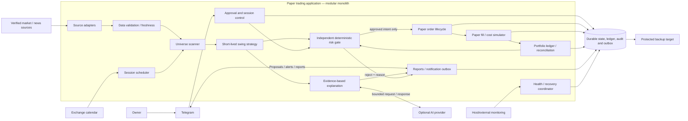
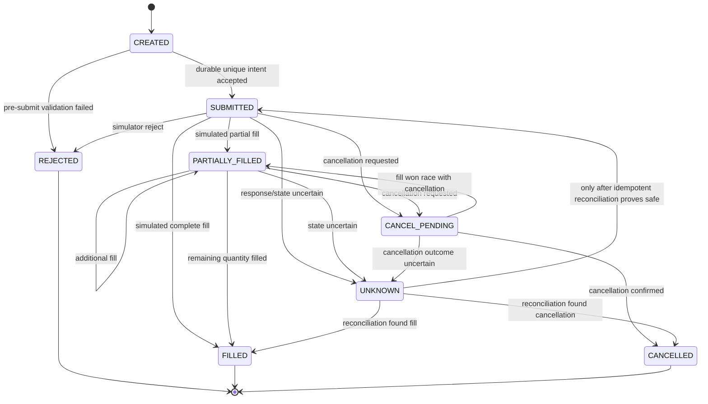

# Groww AI Trading Agent — High-Level Design

## Status and scope

The current application is a paper-only foundation with no live-order path. The
owner's requested destination is an AWS-hosted Groww pilot capped at INR 3,000,
after read-only/staging validation and a separate explicit go-live confirmation.
The current authorization is limited to a costed deployment plan; it does not
authorize AWS provisioning, paid subscriptions, credential collection/use, or
live orders. Groww API and data capabilities must be verified before integration.

The approved strategy direction is short-lived swing trading: positions may cross
session boundaries, are not forcibly sold at each day's close, and should exit at
2% net profit after modeled costs or a protective stop 2% below entry. The owner
selected no fixed maximum holding age; a brief horizon (often around 2–3 sessions)
is intent, not a forced exit. The target cannot be calculated until fill costs and
gap handling are specified. Profit is never guaranteed.

## Architectural principles

1. **Paper-only boundary:** the execution interface accepts only simulated orders.
   There is no live order adapter, funded-account balance input, or live execution
   credential.
2. **Fail closed for entries:** missing approval, stale/invalid data, a risk lock,
   unresolved portfolio state, or unavailable durable storage prevents a new entry.
3. **Deterministic authority:** AI can summarize supplied evidence and explain
   candidates, but cannot create approvals, change risk limits, or authorize orders.
4. **Auditable decisions:** persist the inputs/configuration version, decision,
   reason, and resulting state transition for each entry or exit.
5. **One source of truth:** the portfolio ledger and durable state are authoritative;
   notifications and in-memory caches are derived.
6. **Modular monolith first:** logical components are modules/contracts, not a
   requirement for one container or network service per component. Start with one
   application process and one writer for portfolio/order state unless measurements
   justify a reviewed change.
7. **Recovery before resumption:** restart into recovery mode, reconcile state, and
   validate current data and session controls before enabling entries.

## Logical architecture



The Groww integration is not shown as a dependency for market prices or execution:
its data and API capabilities remain unverified. A verified market-data adapter
must be selected before the scanner can be enabled. Data from a broker or another
provider is not trusted until its use, freshness, coverage, and permitted access
have been checked.

## Component responsibilities and contracts

| Component | Inputs | Outputs / durable effects | Must not do |
|---|---|---|---|
| Source adapters | Provider responses, timestamps, instrument identifiers | Normalized observations with source and receipt metadata | Treat unknown or undocumented data as verified |
| Validator | Normalized observations, source policy, exchange calendar | Valid observations or explicit rejection reasons | Fill missing prices silently or let stale data authorize entries |
| Scanner | Validated observations, verified listing catalog | Deterministically ranked eligible instruments | Use a hard-coded shortlist as the full universe |
| Strategy | Versioned parameters, completed bars, market assessment | Candidate entry/exit decisions, stop and rationale | Set portfolio risk limits or submit orders |
| Analyst | Candidate and bounded evidence bundle | Cited explanation or explicit unavailable/uncertain result | Add unsupplied facts, approve a trade, or bypass a gate |
| Approval/control | Telegram identity and signed/identified action, proposal digest | Persisted approval/rejection/pause/stop action | Approve a changed proposal or act for an unconfigured identity |
| Risk gate | Candidate, approval, ledger snapshot, controls, freshness status | Approved paper intent or rejection with reason | Rely on AI output as risk authorization |
| Paper order manager | Risk-approved intent | Idempotent paper order state transitions | Reach a live broker/order endpoint |
| Simulator | Paper order, market observations, versioned fill assumptions | Simulated fills, rejects, cancellations, fees and slippage | Claim a modeled fill is an actual market execution |
| Portfolio ledger | Fills, fees, marks, adjustments | Cash, positions, exposure, realized/unrealized P&L, net liquidation | Double-count realized P&L or hide unreconciled state |
| Reports/outbox | Durable domain events and status | Telegram messages and daily simulated report | Make successful delivery a prerequisite for protective local logic |
| Recovery coordinator | Persisted state, health probes, calendar and source health | Safe-mode/ready state transitions and alerts | Resume entries on uncertain state |

Components communicate through typed domain commands/events and explicit error
results. A failure is not converted into an empty successful result. State-changing
commands are idempotent and transactionally persisted before downstream work.

### Core command/result contracts

These are logical contracts, not serialized/API compatibility commitments:

| Contract | Required input | Result | Failure behavior |
|---|---|---|---|
| `EvaluateMarket` | Exchange session, source observations, source-policy/config versions | Market assessment plus evidence references, or no-trade reason | Missing/stale/conflicting required evidence cannot produce `FAVORABLE` |
| `BuildProposal` | Approved strategy version, validated candidates, risk inputs | Immutable proposal with digest, instruments, quantities, exits, costs, risks and expiry | Missing sizing/exit inputs means no proposal |
| `RecordApproval` | Authenticated actor, exact proposal digest, action, timestamp, replay/idempotency key | Durable approval/rejection linked to the exact batch | Identity, expiry, digest or replay failure rejects action |
| `EvaluateEntry` | Candidate, approval, ledger version, session/risk locks, validated data | `APPROVED` intent or `REJECTED` with stable reason codes | Unknown/stale state fails closed; no order-side effect |
| `SubmitPaperIntent` | Unique approved intent and simulator model version | Paper order identifier and initial state | Duplicate intent returns the original result; unknown result requires reconciliation |
| `ApplyPaperEvent` | Order/fill/cancel event, unique event key | Updated ledger version and accounting result | Duplicate event is idempotent; inconsistent event moves workflow to recovery |
| `EvaluateExit` | Position, valid mark/bar, strategy version and active exit state | Exit intent/reason or explicit no-trigger | Missing mark prevents new entries and raises a valuation warning; never invent a fill |

Every decision result carries the session/batch/intent identifiers, relevant
configuration versions, timestamp, and a reason. Rejections are first-class
results and are auditable. No generic `success` response is returned for missing
or invalid data.

### Order state transitions



Terminal states are immutable except for separately recorded corrections. Every
transition checks the prior state and unique event key. Position and cash changes
derive from fills/fees exactly once; an order-status notification alone is not a
portfolio event.

## Entry and exit flow

```mermaid
sequenceDiagram
    autonumber
    actor Owner
    participant Telegram
    participant App as Application
    participant Data as Data / Calendar
    participant Strategy
    participant Risk
    participant Store as Durable ledger
    participant Sim as Paper simulator

    App->>Data: Load current-session evidence and completed bars
    Data-->>App: Normalized observations + source/time metadata
    App->>App: Validate universe, calendar, freshness and integrity
    App->>Strategy: Scan only validated inputs
    Strategy-->>App: Candidate batch and proposed position rules
    App->>Telegram: Send proposal, risks, sizing and expiry
    Owner->>Telegram: Approve or reject exact proposal
    Telegram->>App: Authenticated action bound to proposal digest
    App->>Store: Persist approval and session controls
    App->>Risk: Candidate + approval + current ledger/control snapshot
    Risk->>Risk: Check all deterministic entry gates
    alt Every gate passes
        Risk->>Store: Persist unique approved paper intent
        Risk->>Sim: Submit paper-only order
        Sim->>Store: Persist simulated order/fill/cost events
        Store-->>App: Updated cash, position and P&L
    else Any check fails or state is uncertain
        Risk->>Store: Persist rejection and reason
        Risk-->>App: Reject entry; do not submit
    end
```

An approval binds at least the exchange session, proposal/batch identifier and
digest, strategy/risk configuration versions, approved capital and limits, exact
instrument listings, maximum quantities/allocations, approver identity, decision
time, and expiry. Any material change invalidates the affected approval. A closed
position never authorizes reuse of its capital for another instrument; a new entry
batch requires a new approval.

The proposal expiry duration, Telegram identity setup, and recovery/reapproval
policy still require confirmation. Any placeholder expiry in code is not an
accepted operational value.

**Exit path:** deterministic stop, profit-taking, and time/invalidating-condition
rules are owned by the strategy version and run without a second approval after
the entry was approved. The exit intent is persisted and passed only to the paper
simulator. The breaker locks new entries and does not, by itself, liquidate open
positions. Exit notification failure is queued/retried and must not reverse or
disable an already authorized simulated exit. The owner selected a 2% net-profit
exit after modeled costs, a 2% stop below entry, and no maximum age. Cost/gap
assumptions and actual simulated fills must be implemented before enabling exits.

## Portfolio and daily loss accounting

The ledger tracks simulated cash, open positions, entry reservations, fills,
charges, marks and realized/unrealized P&L. For each IST exchange trading session:

- Freeze the approved risk capital for that session.
- Snapshot session-start net liquidation value from cash plus marked open positions
  less applicable accrued simulated costs, including carried positions.
- Compute session P&L as current net liquidation value minus that baseline, with
  realized and unrealized P&L and costs counted once.
- At or below the approved 1.5% loss threshold, durably lock new entries for the
  remainder of the session, invalidate unfilled entry approvals and cancel
  unfilled paper entry orders. Continue existing position-specific exits; do not
  blanket-liquidate positions solely because the breaker fired.
- Reset only at the next valid exchange session after recovery/reconciliation.
- If an open position has no valid current mark, block entries and alert; preserve
  the last valid mark for protective management while marking valuation uncertain.

The domain model currently in `instruments.py` is not a ledger and does not perform
these calculations from fills, marks and costs. Durable accounting and enforcement
remain implementation work.

## State and order lifecycle

Logical durable records:

- `session`: IST exchange-session identity, frozen capital, config versions, state
  (`PREPARING`, `AWAITING_APPROVAL`, `ACTIVE`, `ENTRIES_LOCKED`, `CLOSED`).
- `proposal` / `approval`: immutable proposal digest, approver, decision, expiry,
  allowed symbols/quantities/capital and strategy/risk versions.
- `signal`: source-data references, inputs, strategy version, decision and reason.
- `order_intent`: unique idempotency key, approval link, risk decision and status.
- `paper_order`: status (`CREATED`, `SUBMITTED`, `PARTIALLY_FILLED`, `FILLED`,
  `CANCEL_PENDING`, `CANCELLED`, `REJECTED`, `UNKNOWN`).
- `fill`, `position`, `ledger_event`: immutable simulated execution/accounting
  events and current derived portfolio view.
- `risk_lock`, `operator_action`, `audit_event`, `notification_outbox`,
  `source_health`: locks, controls, traceability, retryable notifications and
  data/health status.

`UNKNOWN` is never treated as failed or safe to retry. Reconcile from durable paper
events and simulator state before retrying. Persist the unique intent and state
transition before performing a side effect; use a transactional outbox for external
notifications. Do not share a transaction across the Telegram/AI/data provider and
the portfolio database; persist a request/idempotency key first, perform the
provider call, then persist its result or uncertainty for reconciliation.

Backups must capture one consistent database snapshot, including its write-ahead
log if applicable, plus schema/migration version, audit history, and the exact
non-secret configuration versions needed to interpret state. Never back up secret
values as part of application state. Encrypt backups, restrict and audit restore
access, retain independent copies, and validate a restore in a clean environment
before declaring readiness. Backup frequency, retention, recovery targets and
restore tooling remain to be selected and approved. The exact database engine,
schema/migrations, and concurrent-writer behavior are design decisions to validate
before T14/T15.

## Deployment and trust boundaries

**Initial topology proposal:** one Linux EC2 host in AWS Mumbai (`ap-south-1`) with
Docker Compose after local paper reliability is demonstrated. Logical modules may
run in one application container; do not turn each module into a service without
measured need. Keep one active state writer. Encrypted persistent storage and
protected backups are required. A single host is recoverable, not highly available;
host or Availability Zone failure can cause downtime.

No AWS resource is authorized for creation by this design. Instance size, database,
backup retention, external heartbeat provider, log retention, network exposure and
all prices remain to be verified and approved. AWS Budget alerts are notifications,
not hard spend caps.

Trust boundaries:

- Telegram actions must be authenticated against an explicitly configured owner
  identity, bound to a proposal/session, and protected against replay.
- Provider and AI responses are untrusted input. Validate shape, provenance,
  timestamps and bounds before use.
- AI receives only the minimum evidence required; it has no order, database-write,
  secret, or approval capability.
- Secrets are injected from an approved local/cloud secret mechanism, excluded
  from source control and logs, and rotated. No live execution credentials exist
  in v1.
- Restrict filesystem and host access; encrypt state/backups; redact tokens,
  personal data and account identifiers from logs.
- The simulator must be an explicit implementation with no generic broker adapter
  fallback or network route that could accidentally submit a real order.

## Failure and safe-mode policy

| Failure | Entry behavior | Existing paper position / recovery behavior |
|---|---|---|
| Missing, stale, invalid or conflicting market data | Reject affected candidates; block if portfolio valuation is unreliable | Retain last valid mark, preserve exit policy, alert |
| Telegram unavailable or approval invalid/expired | No new entries | Continue local deterministic exit handling; queue notifications |
| AI unavailable or malformed response | Continue only if AI is optional for that decision; otherwise no proposal | Never block protective exits |
| Daily loss threshold reached | Persist sticky session lock; cancel/invalidate unfilled entries | Continue position-specific exits; no blanket liquidation |
| Database unavailable, disk full or state uncertain | Block state-changing entries | Do not invent fills; alert and recover/reconcile |
| Process/host restart | Start in recovery mode; no entries | Restore/rebuild ledger; resume only after reconciliation and gates pass |
| Unknown simulator outcome | No retry/new entry | Reconcile by idempotency key before any retry |
| Backup or restore check fails | Readiness remains false; no deployment/evaluation gate | Alert; restore/test from a protected copy |
| Host heartbeat missing | No remote entry action is possible | Independent monitor alerts; single-host outage can interrupt exit management |

Recovery-time, recovery-point, freshness, heartbeat, alert and retention targets
must be owner-approved and tested. Until then, numerical values in prototype
models are placeholders, not service commitments.

## Open design gates

| Gate | Still required before implementation |
|---|---|
| Strategy (T02/T04) | Implement the owner-selected 2% net-profit exit and 2% protective stop; no age limit. Validate actual fills, costs, gaps, and daily mark rules before enabling exits. |
| Approval (T05) | Telegram owner identity, proposal expiry, and restart/recovery approval policy. |
| Recovery (T06) | Approved measurable RTO/RPO, freshness, heartbeat, alert and retention targets. |
| Spending (T07) | Current quotations and owner-approved hard spending ceiling; budget alerts alone are not caps. |
| Evaluation (T08) | Metrics and thresholds accepted before collecting evaluation sessions; defaults in code are not approved. |
| Providers (T09) | Current official Groww and market/news provider capability, permission, coverage, freshness, and cost verification. |
| Simulation (T10) | Worked fill/cost/gap/partial-fill examples and owner approval of assumptions. |
| State/security (T11/T12) | Review component contracts, storage engine, transaction model, schema, backup and secret choices against verified dependencies. |
| Readiness (T13) | Resolve blocking decisions and record separate explicit implementation authorization. |

## Delivery boundary

The repository currently contains domain models and unit tests only. It has no
application startup, persistent ledger, provider adapters, Telegram bot, strategy
runtime, simulator, monitoring service, or deployable infrastructure. This HLD
documents intended boundaries and safe behavior; it does not mark those delivery
tasks complete.
